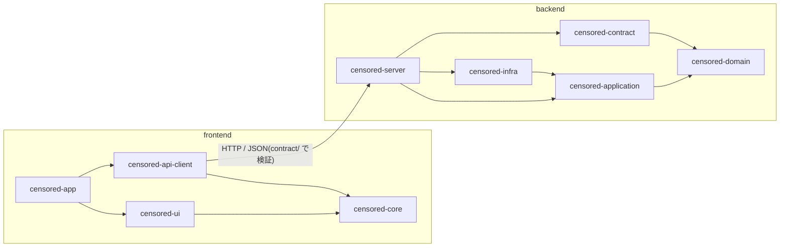

# アーキテクチャ概要

全体の地図を置く。判断の理由は [ADR](../adr/README.md)、パッケージの構成は [ディレクトリ構成](../conventions/01-directory-structure.md) が正本。

候補の生成は、利用者のブラウザの中で LLM を動かして行う(WebGPU。使えなければ WASM)。サーバーに AI の部品は無く、届いた本文を検証して保存するだけである。ランタイムとモデルは [#16](https://github.com/asuka1975/censored/issues/16) で決める([ADR-0012](../adr/0012-browser-llm-runtime.md)、[評価の手順](browser-llm-evaluation.md))。

データストア、配信方式、デプロイ構成は未決定。決定したら ADR を書き、ここに反映する。

書記素の分割に使う ICU([ADR-0009](../adr/0009-grapheme-counting.md))は実行環境にも要る。その脆弱性の検知と更新の方針は未決で、[asuka1975/censored#3](https://github.com/asuka1975/censored/issues/3) で決める。
